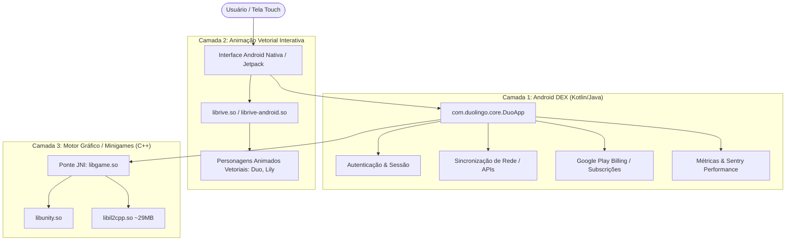

# 🏗️ Arquitetura Híbrida: DEX vs Unity vs Rive

O Duolingo resolve um dos maiores dilemas de aplicativos móveis educativos: **como oferecer uma experiência visual rica e gamificada como um jogo, sem abrir mão da fluidez, acessibilidade e integração nativa de um app Android?**

A resposta encontrada na engenharia reversa é uma **arquitetura híbrida de três pilares**:

Voltar ao [[00 - MOC (Índice Geral do Cofre)|MOC]].

---

## 📐 Visão Estrutural

---

## 🧱 Os Três Pilares Técnicos

### 1. Camada DEX: Aplicação e Negócio
* **Tecnologia**: Kotlin / Java compilado para bytecode Dalvik (DEX).
* **Função**: Controla a navegação de abas (Aprender, Histórias, Praticar, Perfil, Loja), orquestra o ciclo de vida Android, gerencia banco de dados local SQLite/Room e faz requisições HTTP REST/Protobuf para o backend do Duolingo.
* **Vantagem**: Consome muito menos bateria em tarefas comuns de navegação e mantém compatibilidade nativa perfeita com acessibilidade, teclado e gerenciamento de memória do sistema.

### 2. Motor Vetorial Rive: Personagens Vivos
* **Bibliotecas**: `librive.so` e `librive-android.so`.
* **Função**: Renderização vetorial ultra-rápida baseada em máquinas de estados (*State Machines*).
* **Por que o Duolingo usa Rive?**:
  * Em vez de vídeos pesados ou GIFs que gastariam centenas de megabytes e teriam resolução fixa, o Rive usa curvas vetoriais matemáticas minúsculas.
  * O estado da animação varia em tempo real: se o aluno demora a responder, a coruja pisca ou olha para o relógio; se acerta, comemora efusivamente; se erra, faz cara de preocupação.

### 3. Motor Unity com IL2CPP: Experiências de Jogo Complexas
* **Bibliotecas**: `libunity.so` (~20 MB) e `libil2cpp.so` (~29 MB).
* **Função**: Jogos educativos mais complexos, arrastar de blocos com física, efeitos de partículas e desafios temporizados.
* **Segurança do IL2CPP**: Ao usar C++ compilado em vez de código gerenciado C# tradicional, a engenharia reversa da lógica interna do jogo fica altamente dificultada, prevenindo hacks e emulação de respostas automáticas.

---

## 💡 Lição de Engenharia para Novos Apps
Para apps modernos (como o [[Diretrizes de UX e UI Educacional|ACK-ADMY]]), não é necessário carregar uma engine Unity de 50 MB: bibliotecas como **Rive** ou **Lottie** combinadas com **Web/React/PWA** já entregam 90% da experiência com fração do custo de carregamento.

---

## 🔗 Notas Relacionadas
* [[Ciclo de Vida e Performance (DuoApp)]]
* [[Camada Nativa e JNI (Ghidra & C++)]]
* [[Microinterações e Feedback Visual com Rive]]
