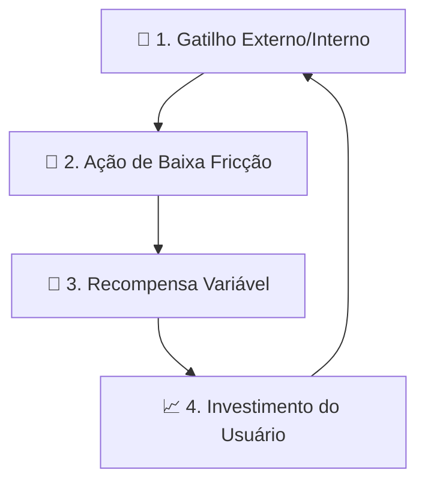

# 🎮 Compêndio de Gamificação e Psicologia Comportamental

Este documento detalha exaustivamente as engrenagens de psicologia comportamental, economia de incentivos e mecânicas de retenção identificadas na análise técnica e nas pesquisas públicas do ecossistema Duolingo.

Voltar ao [[00 - MOC (Índice Geral do Cofre)|MOC Central]].

---

## 1. O Modelo Psicológico de Hábito (Framework de Nir Eyal)

O Duolingo estrutura a jornada diária do aluno em torno do **Ciclo de Hábito (The Hook Model)**:



### Detalhamento das 4 Fases:
1. **Gatilhos (Triggers)**:
   * *Externos*: Notificações push personalizadas com cópias inteligentes, ícones adaptativos do aplicativo que mudam na tela inicial (a coruja fica triste, derretendo ou zangada conforme a proximidade da meia-noite) e lembretes de amigos (*Friend Nudges*).
   * *Internos*: O sentimento de alívio e dever cumprido ao manter o fogo da sequência aceso antes de dormir.
2. **Ação de Baixa Fricção (Action)**:
   * A microlição dura apenas de 3 a 5 minutos.
   * Não há fricção de escolha: a trilha linear aponta exatamente qual botão deve ser pressionado.
3. **Recompensa Variável (Variable Reward)**:
   * Baús misteriosos com quantidades variáveis de gemas.
   * Efeito multiplicador de dobro de XP (*Double XP Boost por 15 minutos*) concedido em momentos imprevisíveis.
   * Comemorações extravagantes a cada nó concluído.
4. **Investimento (Investment)**:
   * O usuário acumula dias na sequência, sobe de divisão na liga, desbloqueia medalhas e acumula vocabulário, tornando o custo de abandono psicologicamente insuportável.

---

## 2. A Neurobiologia da Sequência (Streak)

A sequência diária é o motor primário de retenção e utiliza diretamente a **Teoria da Perspectiva (Kahneman & Tversky)** sobre **Aversão à Perda**:

* **Aversão à Perda**: Perder uma sequência de 100 dias gera uma sensação de frustração desproporcionalmente maior do que o prazer de atingir 101 dias.
* **O Mecanismo do *Streak Freeze***:
  * Funciona como um seguro psicológico. O usuário equipa o congelamento previamente com gemas. Se um imprevisto acontecer, a sequência é preservada.
  * O Freeze consome gemas, o que força o usuário a continuar praticando nos dias seguintes para reabastecer sua reserva de segurança.
* **Proteção Extraordinária de Incidentes**: Documentos de engenharia revelam que, durante quedas de infraestrutura nos servidores centrais, o sistema armazena a tentativa local e reconstitui a sequência retroativamente para não penalizar o aluno por falha técnica.
* **Friend Streak (Sequência em Dupla)**:
  * Permite estabelecer sequências compartilhadas com até 5 amigos mútuos.
  * Introduz **responsabilidade social**: se você não fizer a lição hoje, você não apenas perde o seu fogo, mas apaga o fogo do seu amigo, gerando pressão social positiva para o estudo contínuo.

---

## 3. A Grande Mudança: Vidas (*Hearts*) ➔ Energia (*Energy*)

Uma das análises mais críticas de produto diz respeito à substituição do modelo clássico de Vidas pelo modelo contemporâneo de Energia:

| Característica | Modelo Tradicional (Vidas / Hearts) | Modelo Moderno (Energia / Energy) |
| :--- | :--- | :--- |
| **Gatilho de Débito** | Desconta 1 vida por **erro** do aluno. | Consome carga por **lição iniciada** ou por tempo de estudo. |
| **Impacto Pedagógico** | **Negativo (Aversão ao Risco)**: Alunos hesitavam em tentar frases complexas por medo de errar e ter o estudo bloqueado. | **Positivo (Estudo Ativo)**: Errar não bloqueia imediatamente; o erro passa a ser tratado como ferramenta didática. |
| **Revisão de Erros** | Cobrada ou bloqueada quando as vidas zeravam. | **Totalmente gratuita**: A revisão de erros ao fim da sessão não desconta energia. |
| **Bônus de Recuperação** | Requer prática de lições antigas ou espera passiva de horas. | Concede carga bônus por sequências de acertos perfeitos, baús e anúncios recompensados. |

---

## 4. Dinâmica Social das Ligas e o Diamond Tournament

A competição social do Duolingo é calibrada para evitar o desânimo causado por rankings globais inatingíveis:

```
  ┌────────────────────────────────────────┐
  │         Torneio Diamante (Final)       │
  ├────────────────────────────────────────┤
  │         Torneio Diamante (Semi)        │
  ├────────────────────────────────────────┤
  │        Torneio Diamante (Quartas)      │
  ├────────────────────────────────────────┤
  │          Divisão Diamante (Topo)       │
  │          Divisão Obsidiana             │
  │          Divisão Pérola / Ametista     │
  │          Divisão Esmeralda / Rubi      │
  │          Divisão Safira / Ouro         │
  │          Divisão Prata                 │
  │          Divisão Bronze (Início)       │
  └────────────────────────────────────────┘
```

### Regras de Funcionamento e Matchmaking:
* **Microgrupos de 30 Estudantes**: O algoritmo não cria uma tabela mundial; ele agrupa 30 usuários com ritmos de estudo e fusos horários semelhantes que começaram a primeira lição da semana em horários próximos.
* **O Efeito do Domingo às 22h**: Como as ligas fecham no domingo à noite, gera-se um pico maciço de engajamento (*frenesi de XP*), no qual os usuários ativam poções de dobro de XP para evitar a zona de rebaixamento (últimos 5 colocados) ou garantir o Top 3 da promoção.
* **Privacidade Opcional**: Usuários que preferem estudar sem competição podem ativar o perfil privado nas configurações, o que desliga os leaderboards sem prejuízo pedagógico.

---

## 5. A Trilha Linear (*The Learning Path*) e o Duolingo Score

* **Migração Histórica**: O Duolingo abandonou a antiga "Árvore de Habilidades" (*Skill Tree*) — onde o estudante precisava escolher qual ramificação seguir — e consolidou o formato de **trilha vertical única**.
* **Eliminação da Fadiga Decisória**: O estudante nunca abre o aplicativo perguntando *"o que devo fazer hoje?"*. Ele simplesmente clica no próximo nó iluminado.
* **Duolingo Score (0 a 160)**:
  * Mapeia o progresso do aluno diretamente nas faixas de proficiência do padrão europeu **CEFR**:
    * `0–29`: Nível A1 (Iniciante básico)
    * `30–59`: Nível A2 (Elementar)
    * `60–99`: Nível B1 (Intermediário)
    * `100–129`: Nível B2 (Intermediário independente — topo atual dos cursos mais densos)
    * `130–160`: Nível C1/C2 (Avançado / Proficiente)

---

## 6. A Métrica de Qualidade: "Time Spent Learning Well"

Documentos de pesquisa interna revelam que o Duolingo não busca apenas tempo bruto de tela aberta, mas a métrica:

$$\text{TSLW} = \text{Minutos na Trilha Principal} + 0.5 \times \text{Minutos em Outras Atividades}$$

* **Daily Quests Escalonadas**: Missões diárias em três níveis de dificuldade progressiva que orientam o estudante a avançar nós da trilha em vez de apenas repetir exercícios triviais para acumular XP artificial.

---

## 7. Expansão para Novos Verticais: Matemática, Música e Xadrez

A mesma infraestrutura de gamificação e sessão foi reaproveitada para outras disciplinas:
* **Matemática (Math)**: Mais de 60 unidades curriculares (ensino fundamental e médio), utilizando componentes visuais de frações, geometria e o teclado de fórmulas numéricas (`MTMathView`).
* **Música (Music)**: Ensino de ritmo, percepção auditiva e partitura com teclado de piano virtual na tela, utilizando avaliação em tempo real da tolerância de pitch e timing.
* **Xadrez (Chess)**: Exercícios de tática e minimatches interativos contra o personagem Oscar.
