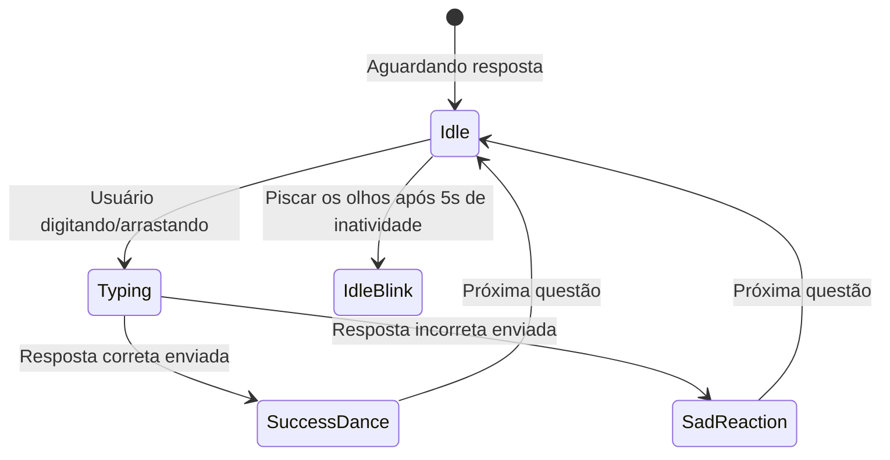

# ✨ Microinterações e Feedback Visual com Rive

A diferença entre um aplicativo chato de perguntas e respostas e o Duolingo reside nos **milissegundos após a ação do usuário**.

Voltar ao [[00 - MOC (Índice Geral do Cofre)|MOC]].

---

## ⚡ A Trindade do Feedback Sensorial

Quando o estudante seleciona a opção correta e pressiona "Continuar":

1. **Auditivo**: O acorde maior e brilhante toca instantaneamente (latência zero).
2. **Tátil (Haptic)**: Vibração curta e sutil no motor do aparelho celular.
3. **Visual**:
   * O rodapé da tela sobe em verde vibrante.
   * O personagem Rive comemora com pulo ou dança.
   * A barra de progresso no topo preenche suavemente com efeito de mola (*spring animation*).

---

## 🎨 O Papel das State Machines no Rive

Diferente de uma animação tradicional pré-renderizada (como MP4 ou GIF), o **Rive** utiliza uma máquina de estados:

### Vantagens do Rive:
* **Tamanho insignificante de arquivo**: Arquivos `.riv` de alguns kilobytes substituem gigabytes de frames rasterizados.
* **Resolução infinita**: Fica nítido em qualquer tamanho de tela sem pixelar.
* **Interatividade via código**: Variáveis no código (como `streakCount` ou `isError`) alteram a animação dinamicamente.

---

## 🔗 Notas Relacionadas
* [[Arquitetura Híbrida (Android DEX vs Unity vs Rive)]]
* [[Psicologia do Loop de Engajamento]]
* [[Diretrizes de UX e UI Educacional]]
