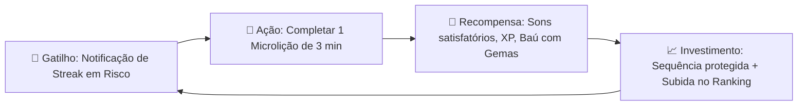

# 🧠 A Psicologia do Loop de Engajamento

O Duolingo é amplamente estudado por ter construído um dos motores de retenção mais eficientes da história dos aplicativos móveis. A análise estrutural revela que o app opera com base no **Modelo de Hábito de Charles Duhigg / Nir Eyal (Gatilho → Ação → Recompensa Variável → Investimento)**.

Voltar ao [[00 - MOC (Índice Geral do Cofre)|MOC]].

---

## 🔄 O Loop Central (*Core Loop*)

---

## 🎯 Os 4 Pilares Psicológicos Identificados

### 1. Aversão à Perda (*Loss Aversion*)
* O ser humano sente a dor da perda com o dobro de intensidade do prazer do ganho.
* Perder uma **Sequência de 50 dias** dói muito mais do que a alegria de alcançar 51 dias.
* Por isso, o "fogo da sequência" (*Streak*) é o elemento de maior destaque na interface.

### 2. Efeito de Progresso Dotado (*Endowed Progress Effect*)
* O Duolingo nunca inicia uma tela ou nível com uma barra de progresso em zero absoluto.
* A primeira questão quase sempre é simples e intuitiva, garantindo que o usuário veja a barra avançar imediatamente em 15% nos primeiros 10 segundos de lição.

### 3. Recompensas Variáveis e Intermitentes
* Se o usuário soubesse exatamente quantas gemas ganharia sempre, o cérebro se acostumaria.
* Por isso, os baús na trilha de aprendizado trazem recompensas com valores randômicos e multiplicadores surpresa (*Double XP Potion por 15 minutos*), estimulando a dopamina.

### 4. Competição Social Contextual (Ligas Pequenas)
* Em vez de colocar o usuário competindo contra 50 milhões de pessoas (o que geraria desânimo), o Duolingo o coloca em uma liga de apenas **30 pessoas**.
* Chegar no Top 3 ou evitar a zona de rebaixamento dos últimos 5 colocados parece uma meta realista e viável.

---

## 🔗 Notas Relacionadas
* [[Sistema de Microlições e Trilha de Aprendizado]]
* [[Sequência (Streak), Vidas e Ligas]]
* [[Microinterações e Feedback Visual com Rive]]
* [[Diretrizes de UX e UI Educacional]]
