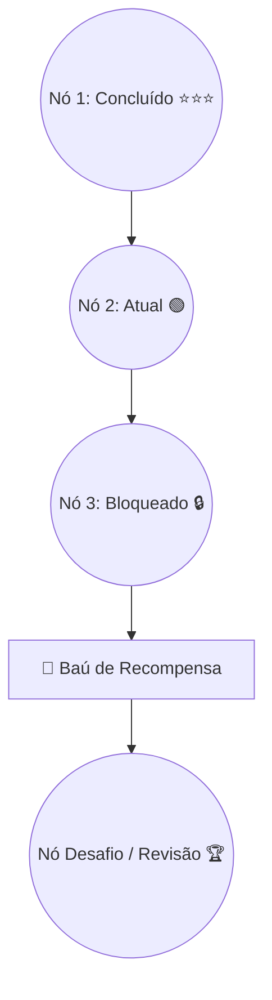

# 📚 Sistema de Microlições e Trilha de Aprendizado

A forma como o conteúdo é fatiado e apresentado na tela é a chave para evitar a sobrecarga cognitiva do estudante.

Voltar ao [[00 - MOC (Índice Geral do Cofre)|MOC]].

---

## ⏳ Microlições: O Conceito de 3 a 5 Minutos

Uma lição padrão do Duolingo não se parece com um capítulo de livro escolar ou um vídeo de 30 minutos.
* **Quantidade de questões por sessão**: entre 10 e 15 desafios curtos.
* **Tempo médio**: 180 a 240 segundos.
* **Variedade de estímulos**:
  1. Múltipla escolha com ícones visuais.
  2. Tradução com blocos de palavras arrastáveis (*word bank*).
  3. Audição com velocidade normal e lenta (efeito tartaruga).
  4. Pronúncia com reconhecimento de fala.
  5. Pareamento de pares de vocabulário.

---

## 🗺️ A Trilha Linear (*The Learning Path*)

No passado, o Duolingo usava uma "Árvore de Habilidades" (*Skill Tree*) com múltiplos caminhos abertos. O app migrou para uma **trilha única e linear vertical**:

### Por que a Trilha Linear Venceu?
1. **Eliminação da fadiga de decisão**: O usuário nunca precisa pensar *"o que eu devo estudar hoje?"*. Ele simplesmente clica no próximo círculo pulsante da trilha.
2. **Revisão espaçada integrada**: O algoritmo intercala conceitos antigos dentro de nós novos de forma imperceptível, garantindo fixação pela repetição.
3. **Senso tangível de distância percorrida**: Rolar a tela para cima e ver centenas de nós dourados traz orgulho e satisfação de progresso.

---

## 🔗 Notas Relacionadas
* [[Psicologia do Loop de Engajamento]]
* [[Sequência (Streak), Vidas e Ligas]]
* [[Diretrizes de UX e UI Educacional]]
