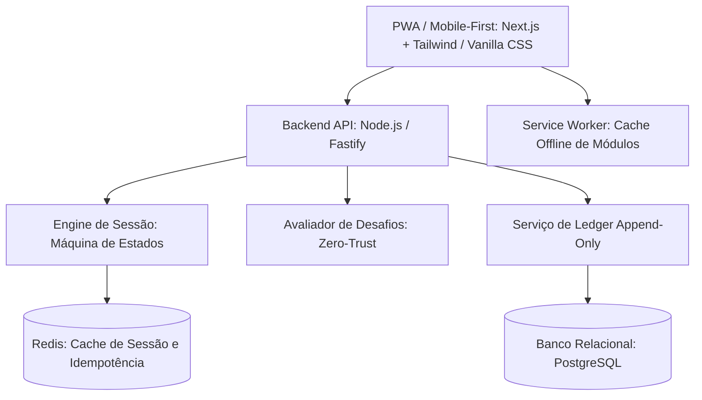

# 🛡️ Compêndio Blueprint: Aplicação Prática no ACK-ADMY e LingoLab

Este documento traduz todas as conclusões de engenharia reversa, psicologia comportamental e arquitetura de software extraídas do Duolingo em um **plano prático de desenvolvimento e design** para o **ACK-ADMY** (aplicativo educacional de segurança digital) e o **LingoLab**.

Voltar ao [[00 - MOC (Índice Geral do Cofre)|MOC Central]].

---

## 1. Visão de Produto: O Que o ACK-ADMY Deve Ser

O ACK-ADMY deve se posicionar como uma plataforma moderna e confiável de conscientização e treinamento em segurança digital:
* **Identidade**: Transmitir proteção, progresso, modernidade e profissionalismo.
* **Sem Aspecto de Trabalho Escolar**: O visual precisa ter padrão de produto refinado (MVP polido pronto para validação de mercado e demonstração a investidores/gestores).
* **Inspiração no Duolingo**: Usar a fluidez, motivação e clareza da gamificação, mas com identidade visual e sobriedade compatíveis com o tema de cibersegurança.

---

## 2. Transposição das Mecânicas de Gamificação para Cibersegurança

| Mecânica Original (Idiomas) | Adaptação para Cibersegurança (ACK-ADMY) | Efeito Comportamental |
| :--- | :--- | :--- |
| **Streak (Sequência Diária)** | **Ofensiva de Proteção Contínua** | Incentiva a prática diária de hábitos de segurança (ex: 1 teste de phishing diário de 2 min). |
| **Hearts / Energy** | **Energia de Investigação / Escudos Digitais** | O aluno utiliza créditos para executar simulações de resposta a incidentes; acertar reforça o escudo. |
| **XP (Experiência)** | **Pontos de Consciência de Segurança (SecPoints)** | Unidade motivacional que mede a consistência do colaborador/aluno. |
| **Ligas Competitivas** | **Ranking de Conscientização por Turma/Setor** | Competição amigável entre departamentos (ex: RH vs Financeiro vs TI) com até 30 membros. |
| **Trilha Linear (Path)** | **Trilha de Blindagem Cibernética** | Etapas progressivas: Senhas Fortes ➔ Phishing ➔ 2FA ➔ Redes Wi-Fi Públicas ➔ Engenharia Social. |
| **Personagem Rive (Duo/Lily)**| **Guardião Digital Interativo** | Mascote vetorizado e profissional que alerta sobre ameaças ou comemora a detecção de malwares. |

---

## 3. Separação Estrita de Experiências: Aluno vs. Administrador

Conforme as diretrizes fundamentais do projeto:

```
┌────────────────────────────────────────────────────────┐
│                   ECOSSISTEMA ACK-ADMY                 │
└──────────────────────────┬─────────────────────────────┘
                           │ Controle de Acesso por Role (RBAC)
         ┌─────────────────┴─────────────────┐
         ▼                                   ▼
┌─────────────────────────┐       ┌─────────────────────────┐
│   PORTAL DO ALUNO       │       │   PAINEL DO ADMIN       │
│ - Gamificação Dinâmica  │       │ - Dashboard Analítico   │
│ - Microlições de 3 min  │       │ - Métricas de Risco     │
│ - Badges e Ofensiva     │       │ - Vulnerabilidades      │
│ - Simulações de Ataque  │       │ - Gestão de Turmas      │
│ - Linguagem Jovem/Clara │       │ - Relatórios Gerenciais │
└─────────────────────────┘       └─────────────────────────┘
```

### Experiência do Aluno:
* **Tom Amigável e Empoderador**: Didático, leve e direto ao ponto, eliminando termos excessivamente burocráticos.
* **Simulações Práticas**: Exercícios onde o aluno analisa prints reais de e-mails de phishing e deve clicar nos cabeçalhos suspeitos ou no link falso.
* **Feedback Imediato**: Explicação clara do motivo de um link ser perigoso imediatamente após a escolha, reforçando o aprendizado na hora.

### Experiência do Administrador:
* **Tom Objetivo e Analítico**: Gráficos de barra e indicadores de postura de segurança, sem elementos infantis ou distrativos.
* **Visão de Risco**: Identificação instantânea dos setores que mais caem em simulações de phishing e necessitam de reforço.
* **Gestão de Acesso**: Bloqueio total a qualquer tentativa de acesso a telas restritas por alunos comuns.

---

## 4. Arquitetura de Software Proposta



### Componentes Chave:
1. **Frontend PWA Mobile-First**:
   * Layout otimizado para celulares com área de toque mínima de `48px` para todos os botões de ação.
   * Respeito às variáveis `env(safe-area-inset-top)` e `env(safe-area-inset-bottom)` para aparelhos com entalhe e barras de gestos.
   * Barra de progresso inspirada no `LessonProgressBarAndroidView` com transições suaves via CSS transitions/Spring.
2. **Backend Baseado nos Contratos `contracts.ts`**:
   * Implementação das rotas: `/v1/courses`, `/v1/sessions`, `/v1/sessions/{id}/attempts`, `/v1/sessions/{id}/completion`.
   * Geração de chaves criptográficas duráveis para cada recibo de lição.
3. **Persistência Imutável em PostgreSQL**:
   * Tabela `security_ledger` onde nenhuma linha sofre `UPDATE` ou `DELETE`, garantindo histórico inalterável de pontuação para fins de auditoria corporativa.

---

## 5. Diretrizes de UX/UI e Checklist de Qualidade para Apresentação

Antes de qualquer demonstração pública ou entrega de versão do ACK-ADMY, deve-se validar:

* [ ] **Contraste e Legibilidade**: Cores de texto atendendo ao padrão WCAG AA.
* [ ] **Hierarquia Visual**: O botão de ação primária (ex: "Verificar", "Continuar") deve ser evidente de imediato.
* [ ] **Tratamento de Todos os Estados de Tela**:
  * Estado de Carregamento (*Skeleton screens* suaves em vez de telas em branco).
  * Estado de Erro (*Mensagens humanas e acolhedoras*, sem expor stacktraces técnicos).
  * Estado Vazio (*Ilustração limpa e convite amigável à ação*).
* [ ] **Responsividade Mobile**: Testado em resoluções de iPhone (390px), Android padrão (360px-412px) e telas desktop.
* [ ] **Segurança de Sessão**: Tentativa de acesso direto via URL `/admin` por usuário com perfil comum deve redirecionar com aviso de permissão sem quebrar o layout.
