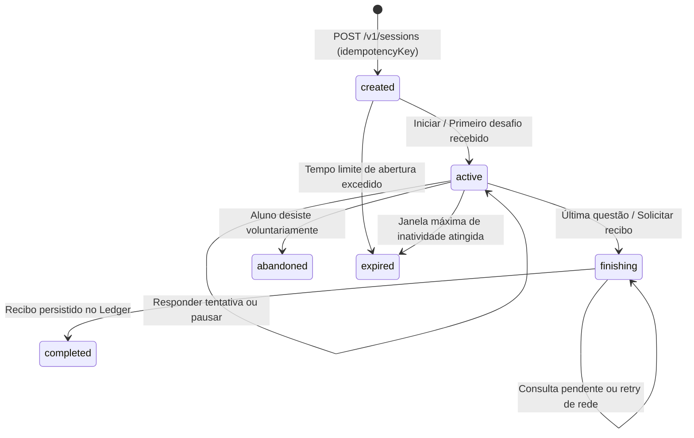

# 📐 Compêndio de Especificação Técnica: SDK Independente de Aprendizado

Este compêndio reúne a especificação formal, contratos de software tipados, modelos matemáticos de retenção e garantias de integridade para a construção de uma plataforma educacional independente baseada nos princípios descobertos na engenharia reversa.

Voltar ao [[00 - MOC (Índice Geral do Cofre)|MOC Central]].

---

## 1. Metodologia e Marcação Epistêmica de Afirmações

Para manter o rigor e a conformidade *clean-room*, cada informação é identificada por seu nível de certeza:

* `[APK-OBS]`: Fato estático observado diretamente no binário (ex: um método ou campo existe).
* `[APK-DER]`: Interpretação de corpo ou fluxo de bytecode descompilado.
* `[PUBLICO]`: Declaração de fonte primária pública oficial da empresa.
* `[REPO-OBS]`: Código ou documentação de repositório público examinado.
* `[INFERENCIA]`: Hipótese fundamentada em evidências, mas ainda sem prova conclusiva.
* `[PROPOSTA]`: Decisão de design ou contrato original criado para a nova plataforma.
* `[DESCONHECIDO]`: Parâmetro não comprovado nem disponível na amostra analisada.

---

## 2. Modelos Matemáticos de Retenção e Inteligência Pedagógica

### A. O Algoritmo HLR (Half-Life Regression)

Proposto formalmente por Settles & Meeder (repositório `duolingo/halflife-regression`, commit `0041df0`), o HLR calcula a probabilidade $p$ de um aluno recordar um determinado conceito/palavra no instante atual:

$$p = 2^{-\frac{\Delta}{h}}$$

Onde:
* $\Delta$: Tempo decorrido (em dias ou frações de dia) desde a última vez que o estudante praticou aquele item específico.
* $h$: Meia-vida da memória daquele item na mente daquele aluno (tempo estimado para a probabilidade de acerto cair para 50%).

A meia-vida $h$ é estimada por regressão logística generalizada através da combinação linear das características do aluno e do vocabulário:

$$h = 2^{\theta \cdot x}$$

* $x$: Vetor de atributos (número de exposições passadas, histórico de acertos vs erros, comprimento da palavra, tempo médio de resposta).
* $\theta$: Vetor de coeficientes (pesos) ajustados pelo modelo.

### B. O Modelo Neural Birdbrain e a "Zona de Flow"

O Birdbrain atua em tempo real na geração de sessões:
* Estima dinamicamente a proficiência atual do aluno $\theta_u$ e a dificuldade do exercício $b_i$.
* A função de probabilidade esperada de acerto segue o modelo logístico da Teoria de Resposta ao Item (TRI):

$$P(\text{acerto}) = \frac{1}{1 + e^{-(\theta_u - b_i)}}$$

* **Calibragem da Taxa Alvo de Sucesso (80% a 85%)**:
  * Se a taxa for > 95%: O aluno experimenta tédio e abandona por falta de desafio.
  * Se a taxa for < 65%: O aluno experimenta frustração e ansiedade, ativando aversão ao erro.
  * O agendador de sessão seleciona itens para manter a taxa média na faixa de **82%**.

### C. O Algoritmo Sleeping Bandit para Notificações

Baseado na pesquisa de bandidos contextuais com penalidade de recência (`RecoveringSleepingBandit`):
* O algoritmo calcula a probabilidade de um aluno abrir o aplicativo diante de templates específicos de mensagem.
* Cada disparo recente impõe uma penalidade temporária de fadiga sobre aquele canal/horário, evitando que notificações repetitivas saturem a atenção do usuário.

---

## 3. Contratos de Software Completos em TypeScript (`contracts.ts`)

Abaixo estão transcritos os contratos tipados que regem o núcleo da plataforma:

```typescript
export type Id = string;
export type Revision = string;
export type Instant = string;   // UTC ISO 8601
export type LocalDate = string; // Civil yyyy-mm-dd

export type ErrorCode =
  | "invalid_input" | "not_found" | "unauthorized" | "forbidden"
  | "conflict" | "resource_exhausted" | "unsupported"
  | "unavailable" | "cancelled";

export interface SdkError {
  code: ErrorCode;
  message: string;
  retryable: boolean;
  operationId?: Id;
  details?: Readonly<Record<string, unknown>>;
}

export type Result<T> =
  | { ok: true; value: T }
  | { ok: false; error: SdkError };

// ─── ESTRUTURA DO CURSO ──────────────────────────────────────────────

export interface Course {
  id: Id;
  revision: Revision;
  subject: "language" | "cybersecurity" | "math" | "music" | "chess";
  uiLocale: string;
  learningLocale?: string;
  title: string;
  sections: readonly Section[];
}

export interface Section {
  id: Id;
  title: string;
  units: readonly Unit[];
}

export interface Unit {
  id: Id;
  title: string;
  objectiveIds: readonly Id[];
  nodes: readonly PathNode[];
}

export interface PathNode {
  id: Id;
  kind: "lesson" | "practice" | "story" | "checkpoint";
  prerequisiteNodeIds: readonly Id[];
  lessonBlueprintIds: readonly Id[];
}

export interface Progress {
  userId: Id;
  courseId: Id;
  courseRevision: Revision;
  revision: Revision;
  nodes: readonly {
    nodeId: Id;
    state: "locked" | "available" | "in_progress" | "completed";
    completedAt?: Instant;
  }[];
}

// ─── RECURSOS E ECONOMIA ─────────────────────────────────────────────

export type AccessResource =
  | { kind: "none" }
  | { kind: "hearts"; current: number; max: number; regeneratesAt?: Instant }
  | { kind: "energy"; current: number; max: number; burnRatePerMinute: number };

export interface StreakStatus {
  currentDays: number;
  qualifiedToday: boolean;
  frozenToday: boolean;
  freezesRemaining: number;
  lastQualifiedDate: LocalDate;
}

// ─── SESSÃO E CONTRATOS DE EXECUÇÃO ──────────────────────────────────

export interface Session {
  id: Id;
  userId: Id;
  courseId: Id;
  pathNodeId: Id;
  revision: Revision;
  state: "created" | "active" | "finishing" | "completed" | "abandoned" | "expired";
  createdAt: Instant;
  currentChallengeIndex: number;
  totalChallenges: number;
  resourceState: AccessResource;
}

export interface ChallengeBase {
  id: Id;
  revision: Revision;
  objectiveIds: readonly Id[];
  prompt: string;
  locale: string;
}

export interface ChallengeAttempt {
  sessionId: Id;
  challengeId: Id;
  attemptId: Id;
  expectedRevision: Revision;
  durationMs: number;
  responsePayload: unknown;
}

export interface AttemptResult {
  attemptId: Id;
  isCorrect: boolean;
  scoreRatio: number; // 0.0 a 1.0
  feedbackMessage?: string;
  correctAnswerSummary?: string;
  resourceRemaining: AccessResource;
}

export interface SessionCompletionReceipt {
  sessionId: Id;
  userId: Id;
  pathNodeId: Id;
  completedAt: Instant;
  xpAwarded: number;
  gemsAwarded: number;
  streakStatus: StreakStatus;
  receiptSignature: string; // Prova criptográfica durável do backend
}
```

---

## 4. O Ciclo de Vida da Sessão e Máquina de Estados



### Regras Mandatórias de Idempotência:
1. **Identificadores Únicos**: Toda tentativa (`attemptId`) e toda conclusão carregam chaves de idempotência. Se a conexão cair após o aluno responder, reenviar a mesma requisição não debitará energia duas vezes nem concederá XP duplicado.
2. **Separação de Chave Privada**: O payload público do desafio enviado à interface **não contém a chave de resposta**. A avaliação e conferência de acerto ocorrem exclusivamente no backend ou por módulo isolado assinado.

---

## 5. Os 11 Formatos de Exercício e Políticas de Correção

| Tipo de Exercício | Estrutura de Resposta do Aluno | Regra de Correção e Tolerância |
| :--- | :--- | :--- |
| `translate_text` | String de texto digitada livremente | Normalização ortográfica consciente; tolerância a 1 caractere de digitação em palavras longas (*Levenshtein distance* $\le 1$). |
| `arrange_tokens` | Array de IDs de blocos selecionados | Ordem posicional estrita; tokens repetidos possuem IDs únicos. |
| `select_choice` | ID da opção única selecionada | Comparação direta contra o ID registrado na chave privada. |
| `fill_blank` | Mapa `{ [lacunaId: string]: string }` | Correção modular por lacuna; erros parciais recebem pontuação proporcional. |
| `match_pairs` | Array de pares `[idOrigem, idDestino]` | Mapeamento biunívoco exato sem duplicatas de vértices. |
| `listen_type` | String transcrita a partir do áudio | Avaliação de acurácia fonética e semântica; pontuação opcional. |
| `speak` | Gravação PCM de voz do usuário | Avaliador de pronúncia retornando confiança percentual e feedback de fonemas. |
| `read_story` | Respostas contextuais por turno | Nós de ramificação em diálogo com avanço conversacional. |
| `math_input` | Expressão textual matemática | Parse em árvore sintática abstrata (AST); proibição absoluta de uso de `eval()`. |
| `music_performance`| Array de eventos `{ note, timestampMs }`| Janela temporal de tolerância de pitch e ritmo (*timing window* $\pm 50$ ms). |
| `chess_move` | Notação algébrica padronizada (ex: `exd5`) | Validador de movimentos legais de xadrez e conferência de objetivo tático. |

---

## 6. O Princípio Crítico contra a Normalização Linguística Ingênua

> [!WARNING] Regra de Ouro da Correção
> **Nunca remover acentos, pontuação ou capitalização de forma global e indiscriminada.**
> * No português: *"avó"* (feminino) e *"avô"* (masculino) têm sentidos opostos; *"esta"* (demonstrativo) e *"está"* (verbo) possuem papéis gramaticais distintos.
> * Na cibersegurança e programação (ACK-ADMY): Comandos de console como `chmod +x` ou nomes de arquivos em Linux diferenciam estritamente maiúsculas de minúsculas.
> * A correção deve sempre registrar três camadas:
>   1. **Entrada Bruta (`rawInput`)**: Exatamente o que o aluno digitou.
>   2. **Forma Normalizada (`normalizedInput`)**: Ajuste aplicado pelas regras específicas daquele idioma/disciplina.
>   3. **Regra Aplicada (`policyApplied`)**: Identificador da regra pedagógica versionada que permitiu ou rejeitou a resposta.

---

## 7. O Ledger Append-Only: Imutabilidade e Zero-Trust no Cliente

O cliente móvel ou web atua sob o princípio de **Zero-Trust**:

```
[Transação 8901] 2026-10-20T11:00:00Z | +20 XP  | Motivo: Conclusão Lição 4 (sess_123) | Autor: Sistema
[Transação 8902] 2026-10-20T11:00:00Z | +5 XP   | Motivo: Bônus de Combo Perfeito       | Autor: Sistema
[Transação 8903] 2026-10-20T11:05:00Z | -10 ⚡  | Motivo: Carga de Investigação         | Autor: Sistema
```

* O saldo é derivado da soma dos eventos confirmados no livro-razão.
* Requisições offline mantêm transações em estado `pending` localmente; nenhuma interface pode exibir conquista como definitiva sem o recibo assinado retornado após a sincronização com o servidor.

---

## 8. Roteiro de Implementação em 8 Fases e Matriz de Testes

### Fases de Entrega:
1. **Fase 1**: Conteúdo autoral próprio e desafios de texto/múltipla escolha com correção determinística.
2. **Fase 2**: Sessão com persistência local, retomada de progresso e garantias de idempotência.
3. **Fase 3**: Ledger append-only de XP, cálculo de streak com tratamento rigoroso de fusos horários e datas locais civis.
4. **Fase 4**: Fila de sincronização e conciliação offline resiliente.
5. **Fase 5**: Componentes de áudio e microanimações vetoriais (Rive/Lottie) com suporte a acessibilidade (movimento reduzido).
6. **Fase 6**: Algoritmo de repetição espaçada adaptativo (HLR) calibrado para a faixa de 80%-85% de acertos.
7. **Fase 7**: Módulo social, missões compartilhadas e ligas de 30 estudantes.
8. **Fase 8**: Módulos avançados de voz, conversação com IA e novos domínios didáticos.

### Matriz de Testes de Borda Obrigatórios:
* Tratamento de Unicode e caracteres acentuados.
* Clique duplo acidental no botão de envio.
* Timeout de rede ocorrido exatamente após o commit do banco no servidor.
* Mudança de fuso horário do aparelho ou transição de horário de verão no meio da sessão.
* Perda de conexão durante exercício de áudio ou gravação de voz.
* Tentativa de envio com revisão de curso obsoleta em relação ao catálogo do servidor.
