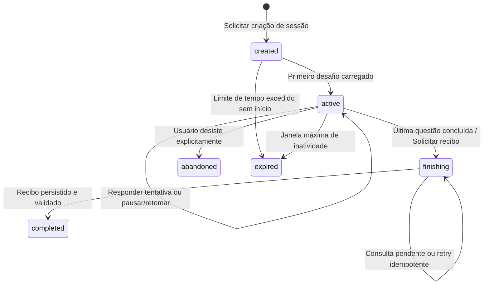

# 🔄 Ciclo de Vida da Sessão e Máquina de Estados

O gerenciamento de uma lição (sessão de estudo) requer garantias rígidas para evitar duplicação de recompensas, perda de progresso no meio da lição ou travamentos por oscilação de rede.

Voltar ao [[05 - Especificação de SDK Independente|Dossiê do SDK]] ou ao [[00 - MOC (Índice Geral do Cofre)|MOC]].

---

## 📊 Diagrama de Estados da Sessão

---

## 🛡️ O Fluxo Operacional Passo a Passo

1. **Pré-requisitos de Abertura**:
   * O cliente carrega a revisão do curso, preferências de acessibilidade (áudio desativado, movimento reduzido) e capacidade do dispositivo.
2. **Criação com Chave de Idempotência (`idempotencyKey`)**:
   * A chamada para criar a sessão carrega uma chave única. Se a rede cair e o cliente tentar criar novamente, o servidor retorna a mesma sessão sem debitar vidas/energia duas vezes.
3. **Payload Público sem Respostas**:
   * O cliente recebe o exercício sem o gabarito no payload JSON. Isso impede que extensões de navegador ou inspeção de rede leiam a resposta certa antes de o usuário responder.
4. **Envio da Tentativa (`ChallengeAttempt`)**:
   * Contém `attemptId`, `sessionId`, `challengeId`, a resposta do aluno e o tempo de resolução em milissegundos.
5. **Conclusão com Recibo Durável (`SessionCompletionReceipt`)**:
   * Ao finalizar, o cliente transita para `finishing` e aguarda o recibo emitido pelo servidor.
   * **Regra de Ouro**: A interface visual só pode disparar a tela de fogos de artifício e comemoração de ganho de XP após receber o recibo criptograficamente assinado.

---

## 🔗 Notas Relacionadas
* [[Contratos TypeScript (contracts.ts)]]
* [[Tipos de Exercícios e Políticas de Correção]]
* [[Economia, Vidas vs Energia e Ledger de XP]]
