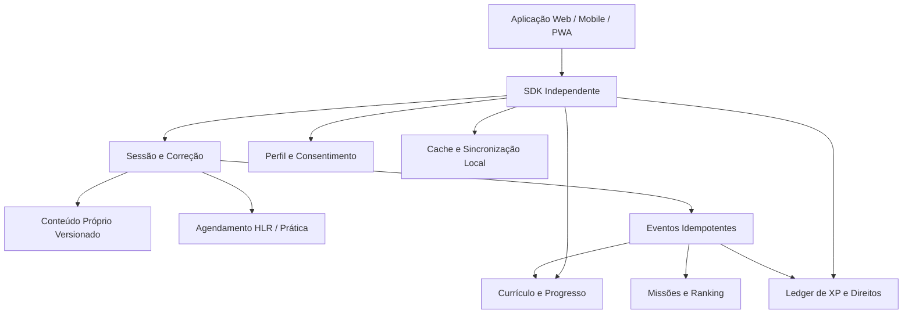

# 📖 Duolingo: Dossiê Técnico e Especificação de SDK Independente

> **Versão documental**: 0.1.0  
> **Data de Pesquisa**: 20/10/2026  
> **Origem**: Análise estática do APK (`Duolingo v6.101.2 (Premium).apk`), dados públicos de pesquisa e contratos originais.  
> Voltar ao [[00 - MOC (Índice Geral do Cofre)|MOC]].

---

## 🎯 1. O que este Documento Entrega

Este pacote reúne evidências do APK selecionado, pesquisa pública e contratos originais para construir um aplicativo de aprendizado independente e interoperável. É uma especificação de SDK limpa (*clean-room*), sem implementação de transporte, servidor ou cliente conectado diretamente aos servidores do Duolingo.

Há duas partes com finalidades diferentes:
- **Dossiê de Pesquisa:** observações do APK (`APK-OBS`, `APK-DER`), saídas de ferramentas (REA, JADX, Ghidra) e fontes públicas (`PUBLICO`, `REPO-OBS`).
- **Especificação Independente:** requisitos, regras e tipos novos (`PROPOSTA`), modelados em [[Contratos TypeScript (contracts.ts)]].

---

## 🧭 2. Sistema de Marcação Epistêmica de Evidências

| Marcador | Significado | Exemplo |
| :--- | :--- | :--- |
| `APK-OBS` | Observação estática direta no artefato ou ferramenta | Campo `ApiGuess` existe no DEX |
| `APK-DER` | Interpretação de corpo ou fluxo de bytecode descompilado | Rotina carrega bibliotecas Unity/IL2CPP |
| `PUBLICO` | Declaração de fonte primária pública oficial | Artigo sobre modelo Birdbrain |
| `REPO-OBS` | Código ou documentação de repositório público examinado | Implementação do HLR no GitHub |
| `INFERENCIA` | Hipótese fundamentada, ainda sem prova definitiva | Dois módulos podem compartilhar mensageria |
| `PROPOSTA` | Escolha de design original para o novo produto / SDK | Estrutura de `/v1/sessions` |
| `DESCONHECIDO` | Não estabelecido pela evidência disponível | Fórmula exata de matchmaking de ligas |

---

## 🗺️ 3. Tópicos e Módulos da Especificação

Explore as notas detalhadas deste módulo:

1. [[Contratos TypeScript (contracts.ts)]] — Interfaces de dados tipadas para cursos, unidades, desafios e sessões.
2. [[Ciclo de Vida da Sessão e Máquina de Estados]] — Estados da sessão (`created → active → finishing → completed`), idempotência e integridade transacional.
3. [[Tipos de Exercícios e Políticas de Correção]] — Os 11 formatos de desafio suportados e estratégias de avaliação server-side.
4. [[Repetição Espaçada e Modelos de Retenção (HLR & Birdbrain)]] — Formulação matemática do HLR (`p = 2^(-Δ/h)`) e estimativas de proficiência.
5. [[Economia, Vidas vs Energia e Ledger de XP]] — Transações imutáveis (*append-only*), controle de streaks e modelo Hearts vs Energy.
6. [[Catálogo de Classes e Origens de Rede]] — Mapeamento de 9.021 classes `com.duolingo` e inventário de endpoints literais observados.

---

## 🏗️ 4. Arquitetura Proposta do SDK

> [!IMPORTANT] Princípio Fundamental de Arquitetura
> O cliente de interface (UI) nunca detém autoridade para conceder XP, validar compras ou avançar nós de progresso. Toda concessão deve retornar um **recibo durável assinado** pelo backend via operação idempotente.

---

## 🔗 Relação com Outras Áreas do Cofre
* [[Visão Geral e Identidade do APK]]
* [[Arquitetura Híbrida (Android DEX vs Unity vs Rive)]]
* [[Psicologia do Loop de Engajamento]]
* [[Diretrizes de UX e UI Educacional]]
