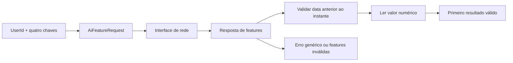

# Duolingo: auditoria estática do APK selecionado

Data: 19/10/2026. Este dossiê cobre inventário integral do contêiner e uma investigação parcial do comportamento. Não é uma análise completa de todos os métodos, nem uma reconstrução do app/backend.

## Alvo e identidade

- Arquivo: `C:\dev\REA\Duolingo v6.101.2 (Premium).apk`.
- SHA-256 calculado nesta execução: `19ae27b023cb2e323a7f5a497b55af966d7118195d3688764913de709a77539f`.
- Tamanho: 200.160.388 bytes.
- Nome de pacote/versão declarados nos relatórios anteriores: `com.duolingo`, `6.101.2`, código `2476`.
- O nome “Premium” não comprova origem oficial ou integridade. Certificado e correspondência com uma distribuição oficial não foram verificados. As conclusões descrevem este arquivo específico.

## Cobertura realizada

| Camada | Resultado | Limite |
|---|---|---|
| ZIP/APK | 17.882 entradas inventariadas, caminhos e tamanhos completos | Inventário não é interpretação de cada recurso |
| DEX | Cabeçalhos dos 10 DEX examinados: 91.761 class_defs | Declarações do formato, não métodos todos decompilados |
| REA/JADX | Busca `com.duolingo` completa no universo apresentado pelo engine: 9.021 correspondências, 76.741 classes no engine | A cobertura do engine não resolve a diferença para class_defs |
| Smali | 91.761 arquivos, 558.143.165 bytes lidos, zero erros de leitura | Indexação textual; não prova de fluxo ou execução |
| Manifesto | 477 componentes da extração preexistente: 233 activities, 210 aliases, 17 receivers, 13 services, 4 providers | XML decodificado não foi independentemente regenerado nesta rodada |
| Nativas | 81 arquivos em ARM64, ARMv7, x86 e x86_64 | Identidade verificada; análise semântica só dos alvos abaixo |
| Ghidra / libduolingounity ARM64 | Análise concluída; inventário e amostra de pseudocódigo exportados | Dependências de sistema não carregadas; chamadas indiretas incertas |
| Ghidra / libil2cpp ARM64 | Importado, 81.246 funções reportadas; análise atingiu prazo | Exportação interrompida; listagem parcial, sem amostra completa |
| Rede | 194 origens de URL encontradas no smali | Nenhuma URL acessada; não equivale a tráfego observado |
| Execução e servidor | Não realizados | Sem captura Android, conta, backend ou decisões remotas |

A contagem dos cabeçalhos DEX coincide com a quantidade de arquivos smali, mas difere das 76.741 classes do JADX. Não foi estabelecido se a diferença decorre de normalização, filtragem, classes duplicadas ou outra característica do engine. Não se deve chamar as 76.741 classes de cobertura integral de todos os class_defs.

## Evidência REA produzida nesta rodada

`classes-duolingo.json` contém o registro completo da busca, sem recorte de tokens:

`ev_581755dbf6a98201ad0e7289f086b5bd123784852ee20b26e278705d289f59bc`.

Provider: JADX headless 0.7.1, um worker, heap informado de 2.020 MiB. A busca confirma nomes de classes, inclusive os candidatos de retenção abaixo. Não comprova seus efeitos em execução.

A inspeção focal da classe de retorno também foi concluída: `ev_2aff118e52a137ddef3893dcc3c8a28eaf221787282bfc31edabf8d8b88f49a4`, íntegra em `retention-class-retry.json`. Foram reportados oito métodos e seis campos. `parseFromFeatures` tem `overload_index: 0` e recebe uma coleção de `FeatureResponse` e um `Instant`.

A decompilação desse método foi concluída pelo REA: `ev_7e4fbf30db830ab50ee121e18bbda0f0de66d122f63c4d643f9fec14658b6a20`, em `retention-method.json`. O provider reportou Java, corpo disponível, fonte completa para esse método, uma sobrecarga e nenhuma representação alternativa usada. Isso confirma a interpretação focal abaixo; não estabelece completude do restante do APK.

As tentativas de `inspect-android-package` falharam com `provider_timeout` de 120.000 ms; os registros estão em `package.json` e `package-retry.json`. O ajuste de `REA_JADX_OPERATION_TIMEOUT_MS` não alterou o prazo reportado pela instalação 6.4.0 usada. Uma primeira consulta focal também expirou (`retention-class.json`). Não foram contadas como análises bem-sucedidas.

O MCP do REA está conectado, mas seu Ghidra está sem `GHIDRA_INSTALL_DIR` e o adaptador Windows P0 reporta aceitar apenas PE, não o ELF ARM64 deste APK. Por isso o Ghidra foi executado diretamente em modo headless. A análise Android bem-sucedida foi pela CLI do REA, não pelo MCP. Não se alterou a configuração do cliente.

## Retenção: o que apareceu concretamente

### Probabilidade de retorno no dia seguinte

Classe confirmada pelo inventário REA:

`com.duolingo.data.churn.TomorrowReturnProbabilityRemoteDataSource$TomorrowReturnProbabilityFeatureSet`.

Arquivo smali examinado: `../../duolingo-extracted/smali_classes5/com/duolingo/data/churn/TomorrowReturnProbabilityRemoteDataSource$TomorrowReturnProbabilityFeatureSet.smali`.

Observações locais: os estados `LATEST` e `PREVIOUS` associam chaves de probabilidade e data, como `latest_tomorrow_prob`/`latest_record_date` e `previous_tomorrow_prob`/`previous_record_date`. O método `parseFromFeatures` percorre uma coleção de `FeatureResponse`, procura a data correspondente, converte-a para `LocalDate`, compara com a data do `Instant` recebido e só prossegue pelo ramo que aceita data anterior. Depois procura o valor numérico correspondente e constrói um objeto com probabilidade, data e instante; ausência/incompatibilidade resulta em null.

Derivação: esse trecho consome e valida uma probabilidade já fornecida; não implementa visivelmente o modelo que a calcula. Não foram recuperados pesos, treinamento, todas as features ou o sistema remoto. A ligação exata desse valor a notificações/recompensas exige rastrear os consumidores.

O consumidor em `../../duolingo-extracted/smali/com/duolingo/data/churn/a.smali` foi examinado diretamente. Ele monta `AiFeatureRequest` com `UserId` e as quatro chaves, chama uma interface de rede, testa `HttpResponse.Success`, lê `AiFeaturesResponse → ProjectResponse → EntityResponse`, obtém as features e percorre o enum até encontrar um resultado não nulo de `parseFromFeatures`. Se não houver resultado válido, retorna `AiFeaturesBackendError.INVALID_FEATURES`; resposta HTTP não bem-sucedida retorna `GENERIC`. Essa é observação do smali local, não um segundo registro REA nem tráfego capturado.

A interface `../../duolingo-extracted/smali/ah0.smali` declara a rota relativa `/v1/features` em uma anotação de método e recebe `AiFeatureRequest`. O host final e o verbo HTTP não foram confirmados nessa inspeção da anotação ofuscada; nenhum endpoint foi acessado.

### Ícones associados à inatividade

`InactiveAppIconCooldownCondition` declara `CONTROL`, `ONE_DAY`, `THREE_DAYS`. No smali examinado, os valores associados são respectivamente 2, 1 e 3; `getCooldownDays()` devolve o valor armazenado. Essa é evidência de parâmetros em dias, não de que uma variante específica esteja ativa para um usuário.

`MoreInactiveAppIconCondition` declara `CONTROL`, `INCLUDE_BUFFERING`, `EXCLUDE_BUFFERING`. Sua inicialização referencia `MORE_INACTIVE_APP_ICONS`; o ramo de exclusão remove `INACTIVE_BUFFERING` do conjunto. O inventário REA confirma a presença da classe. A política final de escolha do ícone ainda não foi rastreada.

### Sequência e recompensas

O REA encontrou `ChurnStreakFreezeRewardView`, `ChurnStreakFreezeRewardFragment` e `TomorrowReturnProbabilityRepository$SubscriptionSource`. São entradas concretas para investigar recompensa de proteção de sequência e retorno. A presença desses nomes não estabelece quando uma oferta é concedida ou sua eficácia.

### Lições, feedback e experimentos

Na extração existem `LessonProgressBarAndroidView`, `LessonProgressBarView`, `ProgressBarStreakColorState` e tipos associados a `SessionQuitSoundEffect`/`SessionQuitHaptics`. A lista de métodos do componente de progresso referencia `ExperimentsRepository$TreatmentRecord` e variantes de barra Rive. Isso indica pontos estáticos de integração entre progresso, experimentos, áudio e feedback tátil; não permite afirmar uma política completa de recompensa.

## Ghidra: o que o código nativo faz nesta amostra

### libduolingounity.so

SHA-256: `653f965fb738564c29de06f1a96ee9880373bc4bfce55befcd6a96ec45d709bf`. Linguagem: `AARCH64:LE:64:v8A`. O cabeçalho do relatório informa 47 funções; o iterador exportou 35 linhas de função e dez amostras de pseudocódigo. A causa exata da diferença entre a contagem do gerenciador e a iteração não foi reconciliada nesta rodada.

O pseudocódigo de `JNI_OnLoad` em `00104a80` procura `com/unity3d/player/NativeLoader` e registra duas funções nativas. A rotina de carregamento em `00104ce4` usa `snprintf`, `dlopen`, `dlsym` e consulta `JNI_OnLoad`; há caminho que seleciona `libil2cpp.so`. As rotinas de descarregamento procuram `JNI_OnUnload`.

Conclusão derivada: esta biblioteca funciona como ponte/carregador nativo Unity. Não há base nesta amostra para atribuir a ela o modelo de retenção. O relatório traz avisos de saltos indiretos não recuperados; pseudocódigo é aproximação.

### libil2cpp.so

SHA-256: `0b82e689ae3931ef57da40384293e2eb2e331ad5a59878fd05560c5cbb644ffb`. Tamanho ARM64: 29.162.960 bytes. O APK também contém `assets/bin/Data/Managed/Metadata/global-metadata.dat`, de 6.933.960 bytes, candidato para uma investigação IL2CPP específica.

O Ghidra importou o ELF e reportou 81.246 funções. O analisador GCC Exception Handlers produziu erros repetidos de limites de funções/landing pads e atingiu o prazo configurado de 120 segundos; o log reportou cerca de 151 segundos nesse analisador antes do cancelamento. O processo foi interrompido durante a exportação posterior. `ghidra-libil2cpp.txt` é parcial: não estabelece cobertura de todas as funções, pseudocódigo completo ou semântica correta de cada corpo.

Foram retidas 80.749 linhas iniciadas por `FUNCTION`; a última está cortada e o marcador `DECOMPILED SAMPLE` não foi alcançado. Portanto esse arquivo não contém uma amostra de pseudocódigo IL2CPP concluída.

O arquivo de símbolos externo `libil2cpp.sym.so` foi referenciado pelo binário, mas não encontrado. Não foi recuperado o projeto C# original nem demonstrado que cada função nativa corresponde a uma função de produto.

## Privacidade, rede e autenticidade

O manifesto decodificado declara microfone, câmera, contatos, calendário, notificações, biometria, internet e estado de Wi-Fi. Permissões declaradas não comprovam uso, consentimento ou frequência de acesso. A lista examinada não contém `ACCESS_FINE_LOCATION` nem `ACCESS_COARSE_LOCATION`.

A indexação encontrou 55 arquivos com termos de localização, incluindo classes do SDK Google Play Services (`FusedLocationProviderClient`, `Geofence`). A simples inclusão de SDK não comprova chamada pelo Duolingo. Não há evidência suficiente nesta rodada para afirmar que o app determina se você está em casa. Inferências remotas por IP ou outros sinais também não foram verificadas.

`network_security_config.xml` na extração permite cleartext para 127.0.0.1 e contém trust anchors de usuário em `debug-overrides`. Isso não demonstra falha explorável nem a aplicação dessa regra numa sessão de produção.

As origens literais incluem API Android, CDN, diagnósticos, TTS e hosts de stage. URLs em texto podem estar inativas, ser de depuração ou pertencer a SDKs. Não houve chamada a endpoints nem inspeção de contas.

As 81 bibliotecas tiveram seus SHA-256 comparados diretamente aos membros ZIP: zero divergências (`native-zip-verification.json`). Isso verifica a extração; não autentica a distribuição perante o fabricante.

## Pendências para uma análise comportamental abrangente

1. Rastrear consumidores de `parseFromFeatures`, limiares e decisões de retenção, com Evidence de métodos e referências.
2. Confirmar controlador de ícones, agendamento de notificações e caminhos de desistência de sessão.
3. Separar código do produto, SDKs e possíveis alterações da distribuição selecionada; validar assinatura contra referência confiável.
4. Investigar IL2CPP com metadata correspondente e concluir análise nativa com uma configuração que evite o analisador problemático, preservando a cobertura omitida.
5. Examinar as outras bibliotecas e arquiteturas; nesta rodada não foram todas decompiladas.
6. Decodificar semanticamente todos os recursos relevantes e configurações, além do inventário.
7. Para comportamento real, observar fluxos em ambiente Android isolado e autorizado. O backend e experimentos ativos não podem ser recuperados integralmente do APK.

## Arquivos para continuar

- `zip-inventory.json`: todas as entradas do pacote e tamanhos.
- `dex-headers.json`: declarações dos dez DEX.
- `classes-duolingo.json`: Evidence REA completo da busca.
- `retention-class-retry.json` e `retention-method.json`: Evidence REA completo da classe e método de probabilidade de retorno.
- `smali-index.json`: candidatos por tema, hashes, métodos e origens de URL.
- `manifest-components.json`: permissões e componentes.
- `native-identities.json` e `native-zip-verification.json`: identidades e verificação.
- `ghidra-libduolingounity.txt`, `ghidra-export.log`: ponte Unity analisada.
- `ghidra-libil2cpp.txt`, `ghidra-libil2cpp.log`: resultados parciais e diagnósticos.

Nenhum arquivo do projeto LingoLab foi alterado nesta investigação.
