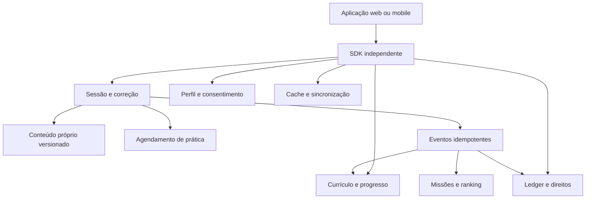
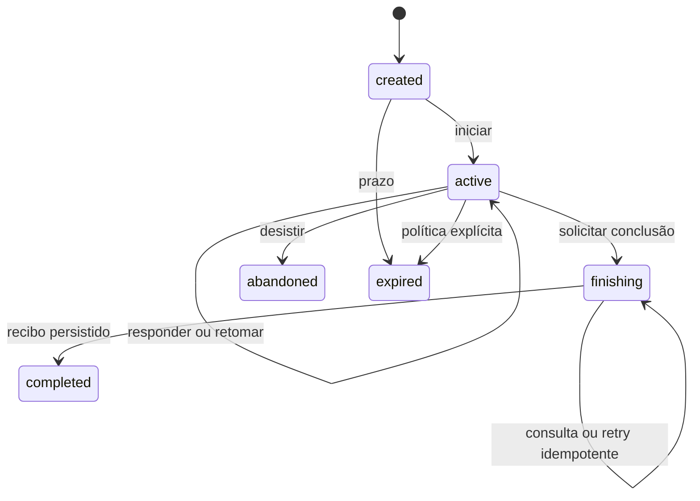

# Duolingo: dossiê técnico e especificação de SDK independente

Versão documental: 0.1.0. Pesquisa: 20/10/2026. Idioma: português.

## 1. O que este documento entrega

Este pacote reúne evidências do APK selecionado, pesquisa pública e contratos originais para construir um aplicativo de aprendizado semelhante. É uma especificação de SDK, sem implementação de transporte, servidor ou cliente conectado ao Duolingo. Não é um SDK oficial, nem uma alegação de compatibilidade com sua API privada.

O levantamento é amplo, mas não contém “todos os segredos” do produto: código remoto, cursos completos, modelos, pesos, experimentos por conta e comportamento não observado continuam desconhecidos. A seção 20 registra cobertura e lacunas. Os anexos preservam o catálogo completo de classes que o REA encontrou, em vez de despejar milhares de nomes nesta leitura.

Há duas partes com finalidades diferentes:

- **Dossiê de pesquisa:** observações do APK, saídas de ferramentas e fontes públicas. Serve para investigar e revisar conclusões.
- **Especificação independente:** requisitos, regras e tipos novos, identificados como `PROPOSTA`. Não contém os corpos decompilados, imagens, personagens, fontes ou material didático do APK.

Como esta investigação teve acesso a código decompilado, não há separação formal entre uma equipe que observa e outra que implementa. Portanto, “clean-room” aqui designa a intenção de especificar uma implementação independente; não certifica um processo formal de isolamento. Para uma implementação com essa separação, entregar à equipe implementadora apenas requisitos comportamentais revisados e conteúdo próprio.

## 2. Como ler as afirmações

| Marcador | Significado | Exemplo |
|---|---|---|
| `APK-OBS` | Observação estática em artefato ou registro de ferramenta | Um campo ou método existe |
| `APK-DER` | Interpretação de corpo ou estrutura recuperada | Uma rotina carrega bibliotecas Unity |
| `PUBLICO` | Declaração de fonte primária pública | Um artigo explica Birdbrain |
| `REPO-OBS` | Código/documentação de repositório público examinado | Um cliente possui certo método |
| `INFERENCIA` | Hipótese apoiada, ainda sem prova suficiente | Dois componentes podem se integrar |
| `PROPOSTA` | Escolha original para o novo SDK/produto | Um endpoint `/v1/lessons` |
| `DESCONHECIDO` | Não estabelecido pela evidência disponível | Fórmula atual de recompensa |

Uma declaração pública histórica não prova a arquitetura de produção em 2026. Uma classe no APK não prova ativação de feature. Código de um cliente comunitário não prova que o endpoint ainda funciona. Falta de resultado de busca não prova ausência de comportamento.

## 3. Identidade do APK e cadeia de evidências

Alvo: `C:\dev\REA\duolingo-analysis\binaries\Duolingo v6.101.2 (Premium).apk`.

SHA-256: `19ae27b023cb2e323a7f5a497b55af966d7118195d3688764913de709a77539f`.

`APK-OBS`: leitura ZIP/DEX desta sessão confirmou 200.160.388 bytes, 17.882 entradas, 10 DEX 039, 91.761 definições de classes, 81 bibliotecas nativas e metadata Unity de 6.933.960 bytes. Fonte: [artifact-identity.json](../artifact-identity.json).

O nome “Premium” é o nome local do arquivo. Autenticidade, assinatura comparada com distribuição oficial e modificações de terceiros não foram verificadas. Existe também um APK 5.158.4; ele não foi escolhido para comparação nesta rodada.

| Evidência | Registro | Alcance |
|---|---|---|
| Inventário de classes | `ev_581755dbf6a98201ad0e7289f086b5bd123784852ee20b26e278705d289f59bc` | 9.021 correspondências `com.duolingo` num universo de 76.741 classes apresentado pelo JADX |
| Classe de retenção | `ev_2aff118e52a137ddef3893dcc3c8a28eaf221787282bfc31edabf8d8b88f49a4` | Membros de uma classe |
| Método de retenção | `ev_7e4fbf30db830ab50ee121e18bbda0f0de66d122f63c4d643f9fec14658b6a20` | Corpo de `parseFromFeatures` |
| Barra de progresso | `ev_08e146d192677902b60a807a85d622cc71afed33001cc145181d0511cdb9ea16` | Nova inspeção de membros nesta sessão |
| Representação de respostas | `ev_07d5a62efbd12891e1f8fcd491e5fb46e0c289e863c3d3925c58a7486aa7f3a8` | Nova inspeção da classe `ApiGuess` nesta sessão |
| Ghidra Unity | [exportação anterior](../../audit-2026-10-19/ghidra-libduolingounity.txt) | Pseudocódigo amostral; saída direta Ghidra, sem ID REA |

Os registros anteriores estão em [audit-2026-10-19](../../audit-2026-10-19/ANALISE.md). Alguns contêm o caminho anterior do APK; a identidade por digest coincide. A diferença entre 91.761 definições DEX e 76.741 classes do engine permanece sem explicação estabelecida.

## 4. Mapa funcional do produto

O catálogo público e o APK apontam áreas diferentes do ecossistema. A presença ou oferta de cada recurso depende de plataforma, curso, país, assinatura, versão e experimento. A pesquisa específica está em [PESQUISA-PRODUTO.md](../PESQUISA-PRODUTO.md); os nomes estáticos estão em [APK-CATALOGO.md](APK-CATALOGO.md).

| Domínio | Pergunta que o SDK deve responder | Evidência ou limite |
|---|---|---|
| Perfil | Quem aprende, em qual idioma e fuso? | Tipos/fluxos locais; identidade remota não observada |
| Currículo | Qual o próximo objetivo de aprendizagem? | Fontes públicas e classes; curso completo não extraído |
| Exercícios | O que apresentar, responder e corrigir? | Classes `core.challenges`; sem catálogo semântico integral |
| Sessão | Qual exercício vem agora e quando termina? | Classes de sessão; regras remotas desconhecidas |
| Prática | O que revisar e com qual prioridade? | Pesquisa pública HLR/Birdbrain; pesos atuais desconhecidos |
| Progressão | Quais nós e unidades foram concluídos? | Inventário e apresentação pública do caminho |
| Sequência | O dia foi qualificado e houve proteção? | Classes de streak/freeze; política integral não rastreada |
| Economia | Quanto XP, saldo e recurso de acesso mudaram? | Tipos locais e features públicas; valores configuráveis |
| Social | Quem acompanha, compete ou coopera? | Tipos de ligas/amizades; matchmaking desconhecido |
| Notificações | Quando lembrar e quando silenciar? | Pesquisa pública e tipos; ação real não observada |
| Assinaturas | Quais direitos estão ativos? | Modelos públicos; validação de recibos não investigada |
| Conteúdo rico | Como tocar fala, animar e contar histórias? | Assets/tipos e artigo oficial de visemas |
| Outros assuntos | Como representar matemática, música e xadrez? | Fontes públicas; cobertura no APK deve ser confirmada por domínio |

## 5. Arquitetura conhecida e arquitetura proposta

`PUBLICO`, histórico: a equipe relatou migração do Android para Kotlin. Isso descreve o código mantido pela equipe na época; não significa que todo byte empacotado, SDK de terceiros ou biblioteca nativa seja Kotlin. [Fonte oficial](https://blog.duolingo.com/migrating-duolingos-android-app-to-100-kotlin/).

`PUBLICO`, 2021: foi descrita a substituição de estado monolítico por repositories e ViewModels/MVVM para reduzir recomputações. É contexto arquitetural publicado, não uma auditoria completa deste APK. [Fonte oficial](https://blog.duolingo.com/duolingo-android-reboot-2021/).

`PUBLICO`, histórico: o Session Generator escolhe exercícios e sequência; uma reformulação descrita usou Scala, dados de curso preparados offline e cache, com dados do aluno fornecidos pelo chamador. Não foram medidos aqui os números de desempenho publicados. [Fonte oficial](https://blog.duolingo.com/rewriting-duolingos-engine-in-scala/).

`PROPOSTA`: no novo produto, separar domínio pedagógico, geração de sessão, correção, progressão e apresentação. Usar módulos com estado próprio e contratos versionados; a UI consome estados prontos para exibição.

O diagrama inteiro é proposta original. Não representa a topologia recuperada dos servidores do Duolingo.

## 6. Currículo, caminho e versionamento

`PROPOSTA`: representar `Course → Section → Unit → PathNode → LessonBlueprint → Challenge`. IDs devem ser estáveis e distintos dos títulos traduzidos. Cada conteúdo leva revisão e origem autoral. Um curso pode ter idioma de interface diferente do idioma de estudo; matemática e música usam `subject` próprio sem inventar um idioma de destino.

Campos mínimos: `courseId`, `revision`, `subject`, `uiLocale`, `learningLocale` opcional, objetivos pedagógicos, pré-requisitos, habilidades, mídia e estado editorial. CEFR é metadata opcional baseada em revisão pedagógica, não uma conclusão obtida de XP.

Estados propostos de nó: `locked`, `available`, `in_progress`, `completed`. Repetição é uma nova sessão com identidade própria. Migração de currículo deve informar mapeamento de IDs, revisões antigas e decisões sobre progresso; nunca sobrescrever silenciosamente uma sessão em andamento.

Conteúdo ainda não publicado ou sem direitos confirmados não entra no catálogo distribuído. Um manifest de mídia deve conter tamanho, digest, idioma, duração quando conhecida e política de cache. O SDK deve exibir indisponibilidade explícita se faltar um recurso obrigatório.

## 7. Tipos de exercícios e correção

`APK-OBS`: o inventário contém `ApiGuess`, `BlankableToken`, `ChallengeDisplaySettings` e `ChallengeImage`. Esses nomes são pistas de modelos de exercício, não uma enumeração exaustiva dos formatos aceitos pelo backend.

A nova inspeção REA de `ApiGuess` confirmou um campo `Companion`, um inicializador estático e as classes internas `Int`, `Null`, `String` e `StringList`. Ela fornece candidatos concretos para representações de resposta; sem examinar seus corpos/serialização, não é possível concluir discriminantes JSON, validação ou equivalência com cada desafio. Registro: [challenge-guess-class.json](../challenge-guess-class.json), `ev_07d5a62efbd12891e1f8fcd491e5fb46e0c289e863c3d3925c58a7486aa7f3a8`.

`PROPOSTA`: a primeira versão do contrato suporta os formatos abaixo, com enunciados e conteúdo originais:

| Tipo novo | Resposta | Correção proposta |
|---|---|---|
| `translate_text` | Texto livre | Conjunto revisado de respostas e política linguística versionada |
| `arrange_tokens` | IDs de tokens em ordem | Sequências permitidas; tokens repetidos têm IDs distintos |
| `select_choice` | ID de alternativa | Alternativas válidas declaradas na chave privada |
| `fill_blank` | Mapa lacuna → texto | Avaliar por lacuna e consolidar sem perder erro parcial |
| `match_pairs` | Pares de IDs | Correspondências completas sem duplicação de IDs |
| `listen_type` | Texto transcrito | Política específica de ditado e idioma |
| `speak` | Referência a áudio do aluno | Resultado de avaliação com confiança e indisponibilidade explícitas |
| `read_story` | Escolhas/respostas por etapa | Condições e rubricas próprias da história |
| `math_input` | Expressão ou número | Parser matemático e unidade, sem `eval` do texto |
| `music_performance` | Eventos de notas e tempos | Janela de tolerância e rubrica versionadas |
| `chess_move` | Movimento em posição identificada | Validade legal e objetivo pedagógico próprio |

Esses nomes são novos e não alegam reproduzir discriminantes internos. Tipos desconhecidos devem ser preservados como incompatíveis, sem renderizar um exercício diferente por aproximação.

Não remover acentos, pontuação ou caixa de forma global: políticas diferem por língua e objetivo. Preservar entrada original, representação normalizada e regra aplicada. Casos como “avó/avô”, ordem de palavras e unidades matemáticas podem alterar o significado. Um corretor baseado em LLM deve poder devolver `needs_review`; indisponibilidade de rede ou incerteza de fala não equivalem a erro do aluno.

## 8. Ciclo da sessão

`PROPOSTA`: estados `created → active → finishing → completed`; saídas adicionais `abandoned` e `expired`. Pausa preserva cursor e rascunho sem conceder conclusão. Cada tentativa tem identidade, índice, timestamps e revisão do exercício.

Fluxo operacional:

1. Carregar a revisão do curso, capacidade do dispositivo e preferências de acessibilidade.
2. Criar sessão com chave de idempotência, política de recompensas e seleção de conteúdo fixadas.
3. Receber exercício público; manter chave de respostas fora do payload público quando há autoridade no servidor.
4. Enviar resposta tipada com `attemptId`, `expectedRevision` e duração medida.
5. Receber feedback; reenviar uma tentativa com a mesma identidade não duplica progresso nem XP.
6. Pedir conclusão e receber recibo durável. Somente esse recibo autoriza a UI a anunciar recompensa confirmada.

Em falha durante conclusão, consultar o resultado da operação antes de tentar uma nova concessão. Cancelar uma requisição de UI não apaga uma transação já confirmada. Isso é desenho do novo SDK, não comportamento observado no APK.

## 9. Personalização e repetição espaçada

`PUBLICO`: Birdbrain estima a probabilidade de acerto por aluno/exercício e informa a construção de sessões. A publicação não entrega pesos nem um modelo executável equivalente ao serviço atual. [Fonte oficial](https://blog.duolingo.com/learning-how-to-help-you-learn-introducing-birdbrain/).

`PUBLICO`/`REPO-OBS`: o trabalho HLR descreve `p = 2^(-Δ/h)` e `h = 2^(θ·x)`, com dados e implementação de pesquisa públicos. É material de pesquisa histórico, não prova do algoritmo atualmente aplicado a todas as lições. [Repositório oficial](https://github.com/duolingo/halflife-regression), [artigo](https://research.duolingo.com/papers/settles.acl16.pdf).

`APK-DER`: no método de retenção examinado, `parseFromFeatures` valida uma data anterior ao instante de referência e extrai uma probabilidade numérica recebida. Isso não recupera o modelo que a produziu. Evidência: `ev_7e4fbf30db830ab50ee121e18bbda0f0de66d122f63c4d643f9fec14658b6a20`.

`PROPOSTA`: três interfaces separadas:

- `RecallScheduler`: estimar revisão por item/habilidade a partir de tentativas.
- `DifficultyEstimator`: estimar probabilidade de acerto e declarar versão do modelo.
- `SessionPlanner`: escolher conteúdo elegível respeitando currículo, modalidade e disponibilidade.

HLR pode ser um baseline de pesquisa. Definir unidade de `Δ` e `h`, limites numéricos, comportamento sem histórico e versão dos parâmetros. Não apresentar probabilidades de acerto ou retenção como medições da capacidade humana sem validação. Avaliar retenção e aprendizagem, além de abertura do app.

## 10. Progresso, cores, áudio e animação

`APK-OBS`: `LessonProgressBarAndroidView` tem 17 entradas de métodos e 15 campos; aparecem `onDraw`, `onSizeChanged`, progresso `float`, `ProgressBarStreakColorState`, `Paint`, `ArgbEvaluator` e `ValueAnimator`. A inspeção de membros não estabelece fórmula de progresso ou duração de animação. [Evidência REA](../lesson-progress-class.json).

`PUBLICO`: a publicação sobre visemas descreve geração de áudio, alinhamento de palavras/fonemas, associação a formas de boca e execução de state machines Rive sincronizadas com áudio. Pose e boca podem coexistir; a reação muda com o resultado do exercício. [Fonte oficial](https://blog.duolingo.com/world-character-visemes/).

`PROPOSTA`: conteúdo visual próprio com estados `idle`, `speaking`, `success`, `retry` e `celebrate`; mídia e timings têm versões/digests. Usar o relógio de reprodução para sincronização e cancelar fala/visemas ao sair. Não presumir que o número ou nome de um visema do Duolingo seja uma convenção padrão.

Separar feedback pedagógico de feedback sensorial. Preferências de movimento reduzido, áudio desligado e vibração desligada devem funcionar sem alterar a resposta correta. O indicador de progresso precisa de semântica definida: exercícios resolvidos, objetivos concluídos ou estimativa; não misturar os três.

## 11. Sequência, XP e economia

`APK-OBS`: há tipos de `StreakFreezeReward`, `CumulativeLessonStats`, `FreezesToUse`, `ShopItem`, `ShopItemId` e `ShopReward`. Os nomes não estabelecem custos, limites ou concessão para uma conta.

`PROPOSTA`: sequência se baseia em dias qualificados no fuso definido pela política, com instante UTC e data local registrados. Distinguir “praticou”, “protegido” e “não qualificado”. Mudança de fuso, viagem e horário de verão exigem regras explícitas e auditáveis. Evitar calcular uma sequência somente dividindo timestamps por 24 horas.

XP é uma unidade motivacional separada de domínio pedagógico. Um ledger append-only concede ou estorna entradas com `sourceOperationId`, revisão de política e motivo. Reprocessar a mesma conclusão retorna o mesmo recibo. Saldo exibido pelo cliente não é autoridade para compras.

Modelar boost, moedas e proteções como políticas e direitos próprios. Valores de recompensa, multiplicadores e preço devem estar em configuração versionada, não como constantes supostamente extraídas do Duolingo. O documento não recuperou a fórmula comercial atual.

## 12. Vidas, Energia e publicidade

`PUBLICO`: a publicação de Energia contrasta o consumo de vidas por erro com um recurso que sustenta lições, se recompõe e admite recuperação por acertos/anúncios/gemas. Ela descreve implantação e experimentação; não fixa parâmetros universais para 2026. [Fonte oficial](https://blog.duolingo.com/duolingo-energy/).

`PROPOSTA`: `AccessResource` tem discriminante `none`, `hearts` ou `energy`; cada variante informa política e estado. Não mapear zero energia para “aluno respondeu errado”. Custo reservado, consumido, devolvido e pendente são estados diferentes.

Recompensa de anúncio precisa de confirmação verificável e deduplicação; simplesmente fechar uma janela não deve criar saldo. Propor uma opção sem anúncios no produto próprio e definir direitos por política. Este documento não descreve remoção ou burla de anúncios/assinaturas do app analisado.

## 12.1. Capacidade de assinatura não deve ser presumida pelo nome

`PUBLICO`: o guia consultado da aba Practice declara acesso gratuito a exercícios de prática e a Explain My Answer; a revisão de Video Call/Roleplay continua descrita em contexto Max. Isso diverge de descrições históricas de benefícios pagos. A matriz de direitos do SDK novo deve ser configurável e explícita. [Guia oficial consultado](https://blog.duolingo.com/guide-to-duolingo-practice-hub/).

## 13. Ligas, amizades, missões e conquistas

`APK-OBS`: existem representações de leaderboard e ligas. A presença não revela critérios completos de grupos, elegibilidade ou desempate. Veja os candidatos no catálogo.

`PROPOSTA`: uma liga é um intervalo com `startsAt`, `endsAt`, `timeZone` quando aplicável, critérios de elegibilidade e política de pontuação. Ranking usa eventos elegíveis confirmados, com desempate explícito e comportamento para empates. Histórico deve continuar coerente após correções de ledger.

Missão separa definição, progresso, conclusão e resgate. Evento repetido não progride duas vezes; resgate concorrente não concede duas recompensas. Missão cooperativa exige participantes e intervalo próprios. Conquistas permanentes não se confundem com metas temporárias.

Relações sociais precisam distinguir seguir, amizade aceita, convite pendente e bloqueio. Preferências de visibilidade pertencem ao perfil; recursos de cooperação não autorizam expor e-mail, localização ou histórico detalhado de estudo.

## 14. Notificações e retenção

`PUBLICO`: o portal de pesquisa lista dados de um estudo de bandits para lembretes recorrentes; dados experimentais não são o algoritmo atual nem seu texto de notificações. [Portal oficial](https://research.duolingo.com/), [repositórios pesquisados](../REPOSITORIOS.md).

`APK-OBS`: o relatório anterior registra variantes de cooldown de ícones inativos e modelos de probabilidade de retorno. A política final e a efetividade não foram observadas. [Auditoria](../../audit-2026-10-19/ANALISE.md).

`PROPOSTA`: `ReminderPolicy` contém consentimento, janela local, dias, quiet hours, limite diário, idioma e canais. Agendamento considera fuso, reenvio e cancelamento. Abrir o app após lembrete é métrica de engajamento; não demonstra aprendizagem causada pelo lembrete.

Para personalização, usar uma política determinística inicial e medir efeitos antes de adotar bandits. Separar probabilidade prevista, decisão tomada e resultado observado. O serviço de mensagens do novo produto envia somente textos próprios e deve respeitar opt-out por canal.

## 15. Voz, histórias, conversação e outros assuntos

`PUBLICO`: artigos descrevem uso de reconhecimento de fala para ditado e feedback. Isso não fornece o endpoint, thresholds ou equivalência entre um reconhecedor genérico e o avaliador de pronúncia do produto. [Fonte oficial](https://blog.duolingo.com/sneaky-pronunciation-practice/).

`PUBLICO`, histórico: criação assistida de exercícios por LLM foi descrita com objetivos curriculares, instruções e revisão de especialistas. Não foram recuperados prompts de produção nem o corpus. [Fonte oficial](https://blog.duolingo.com/large-language-model-duolingo-lessons/).

`PROPOSTA`: interfaces `SpeechRecognizer`, `PronunciationEvaluator`, `SpeechSynthesizer` e `ConversationTutor` independentes. Transcrição não equivale a nota de pronúncia. Cada resultado informa modelo, idioma, confiança quando disponível e estado `unavailable` ou `needs_review`.

Histórias usam cenas, turnos, personagens originais e perguntas; progressão narrativa não deve depender de segredo da chave de respostas no cliente. Conversação com IA tem objetivos e rubrica próprios, cancelamento, recuperação de conexão e retenção de áudio declarada.

Matemática precisa de sintaxe e unidades; música precisa de tempo musical, notas e latência; xadrez precisa de posição, turno, regras e objetivo. Esses domínios compartilham infraestrutura de sessão, mas mantêm correção específica. As fontes públicas adicionais estão no anexo de produto; o suporte efetivo no APK não foi presumido a partir da web.

## 16. Persistência, offline, cache e experimentos

`PUBLICO`, relato de engenharia de 2024: a equipe descreveu postergar prefetch de lições/SDKs e reduzir o volume de metadata carregado na abertura. Também descreveu processamento de respostas por usuário e buffer de atualizações do modelo. São escolhas publicadas na época, não benchmarks desta análise. [Fonte oficial](https://blog.duolingo.com/unique-engineering-problems/).

`PROPOSTA`: cache por revisão de curso e digest de mídia; estado pessoal por usuário e versão, sem compartilhamento entre contas. Offline oferece apenas os formatos que possam ser corrigidos com autoridade definida. A fila de operações armazena IDs estáveis e dependências, não requisições anônimas que duplicam ao reconectar.

Resolver conflitos com revisão esperada e resultado explícito `conflict`, preservando a tentativa local. Conclusão offline pode ser `pending`; não dizer que ranking e compra foram confirmados remotamente. Exportar e apagar dados devem incluir operações pendentes e mídia pessoal.

Experimentos precisam de atribuição estável por escopo, versão de configuração, critérios de elegibilidade e registro de exposição. Receber configuração não é igual a ver a experiência. Uma sessão guarda a política com que começou para evitar mudança de regra no meio da lição.

## 17. Rede, permissões e fronteiras de confiança

`APK-OBS`: a extração anterior registra permissões para áudio, câmera, contatos, calendário, notificações e outras integrações Android. Permissão declarada não comprova acesso efetivo. O manifesto decodificado preexistente não foi regenerado nem independentemente vinculado ao APK nesta rodada. Inventário completo e essa limitação estão no catálogo.

`APK-OBS`: a busca textual anterior encontrou 194 origens de URL. Elas podem pertencer ao produto, dependências ou código inativo; nenhuma foi acessada para testar API. Origem literal não comprova endpoint operacional, autenticação nem exfiltração.

`REPO-OBS`: existem clientes comunitários com métodos de perfil e progresso. A documentação e o código de um wrapper são evidência do wrapper, não de um contrato oficial atual. Não foi localizado no material consultado um contrato público oficial suficiente para um SDK geral compatível. Não foram testadas contas nem endpoints. [Pesquisa de repositórios](../REPOSITORIOS.md).

A página pública de privacidade foi acessada, mas o extrator retornou conteúdo insuficiente; esta investigação não resume seus termos nem conclui conformidade. [Página consultada](https://www.duolingo.com/privacy).

`PROPOSTA`: o novo SDK usa domínio do novo produto, autorização própria e opt-in granular. Não persiste credenciais em exemplos ou catálogos. Não solicita microfone para exercício de texto. O servidor valida direitos de acesso e transações; dados de UI não autorizam concessões. Dados pessoais, gravações e preferências têm prazo e escopo próprios.

## 18. Contrato do SDK independente

Os tipos em [contracts.ts](contracts.ts) são originais e documentais. Eles não foram convertidos em JSON Schema, anunciados pelo REA ou conectados a nenhum serviço. O contrato apresenta o núcleo de sessão/correção/progresso; os módulos de loja, social e IA são requisitos de extensão, não APIs já implementadas.

| Operação proposta | Entrada principal | Resultado | Efeito |
|---|---|---|---|
| `getCourse` | ID e revisão opcional | Curso versionado | Leitura |
| `getProgress` | Usuário e curso | Estado de nós | Leitura |
| `createSession` | Objetivo e chave idempotente | Sessão | Criação |
| `getChallenge` | Sessão e cursor | Exercício público | Leitura |
| `submitAttempt` | Exercício, tentativa, revisão e resposta | Feedback | Gravação idempotente |
| `finishSession` | Sessão, revisão e chave | Recibo de conclusão | Transação idempotente |
| `abandonSession` | Sessão e motivo | Estado final | Transição idempotente |
| `getOperation` | ID da operação | Resultado confirmado ou pendente | Leitura para recuperação |

Transporte HTTP futuro sugerido: `/v1/courses`, `/v1/progress`, `/v1/sessions`, `/v1/sessions/{id}/attempts`, `/v1/sessions/{id}/completion` e `/v1/operations/{id}`. Essas rotas são invenção deliberada para o novo servidor. Não devem ser enviadas para domínios Duolingo.

Falhas esperadas: `invalid_input`, `not_found`, `unauthorized`, `forbidden`, `conflict`, `resource_exhausted`, `unsupported`, `unavailable`, `cancelled`. Um erro transportado não deve perder fatos parciais nem converter estado pendente em ausente. Validadores de fronteira e autenticação são trabalho de implementação futura.

## 19. Exemplos originais e roteiro de implementação

Exemplo de conteúdo próprio: curso de inglês para interface em português, objetivo “cumprimentar”, pergunta “Selecione uma saudação”, alternativas “Hello”, “Table”, “Window”. IDs e frases são exemplos novos; não são extrações de uma lição do APK.

Sequência de entrega proposta:

| Etapa | Entrega | Critério verificável |
|---|---|---|
| 1 | Conteúdo próprio + texto/alternativas/tokens | Respostas revisadas e correção determinística |
| 2 | Sessão + persistência + retomada | Reabrir não perde cursor; retry não duplica tentativa |
| 3 | Progresso + sequência + ledger | Datas/fusos testados; conclusão única por operação |
| 4 | Offline e sincronização | Interrupção antes/depois de confirmar converge |
| 5 | Áudio e animação próprios | Cancelamento, microfone negado e movimento reduzido |
| 6 | Revisão adaptativa | Baseline e métricas pedagógicas verificáveis |
| 7 | Social, missões e assinaturas próprias | Concorrência, privacidade e concessões auditáveis |
| 8 | Conversação e novos assuntos | Rubrica, custo, latência e fallback específicos |

Matriz de validação futura: Unicode e idiomas; alternativa duplicada; resposta parcial; tentativas simultâneas; clique duplo; replay de conclusão; timeout após commit; mudança de fuso; horário de verão; sessão em revisão antiga; áudio ausente; gravação interrompida; conteúdo incompatível; cache corrompido; usuário trocado; conta apagada com fila pendente; anúncio sem confirmação; resgate concorrente; indisponibilidade do corretor.

Esses são critérios propostos. Não foram executados contra o Duolingo, nem existe implementação deste SDK para aprová-los.

## 20. Cobertura, lacunas e limites

| Pergunta | Estado | Próxima evidência necessária |
|---|---|---|
| Qual arquivo foi analisado? | Respondida por digest | Assinatura oficial ainda pendente |
| Quais classes o REA encontrou? | Catálogo preservado | Reconciliar diferença DEX/JADX |
| Quais módulos parecem existir? | Parcial, nomes estáticos | Rastrear entry points e consumidores |
| Como funciona uma regra de retenção? | Um método examinado | Modelo remoto e políticas consumidoras |
| Como a barra é representada? | Membros inspecionados | Corpos e fluxo da lição |
| O que faz a ponte Unity? | Amostra interpretada | Análise IL2CPP completa e metadata correlacionada |
| Qual o contrato privado de rede atual? | Não estabelecido | Captura autorizada e schemas por versão |
| Quais as regras exatas de ranking/XP? | Não estabelecidas | Fluxos reais e regras de servidor |
| Que conteúdo está no servidor? | Não recuperado | Fonte autoral própria para o novo produto |
| Como são pesos/prompts de produção? | Não recuperados | Não disponíveis nas evidências consultadas |
| O APK rastreia localização ou usa toda permissão? | Não demonstrado | Fluxos e observação específicos |
| O SDK novo funciona? | Apenas especificado | Implementação e testes próprios |

Não houve execução Android, emulador, login, compra, modificação do APK ou chamada exploratória a endpoints do Duolingo. As fontes web foram lidas para pesquisa. REA e Ghidra são ferramentas de análise; não tornam completo o que não foi examinado. [REA](https://github.com/morluto/rea), [Ghidra](https://github.com/NationalSecurityAgency/ghidra).

## 21. Entregáveis e uso recomendado

- [APK-CATALOGO.md](APK-CATALOGO.md): mapa e inventários locais com limites.
- [sdk-apk-catalog.json](sdk-apk-catalog.json): catálogo consultável de nomes/classes e proveniência.
- [PESQUISA-PRODUTO.md](../PESQUISA-PRODUTO.md): funcionalidades públicas e fontes.
- [REPOSITORIOS.md](../REPOSITORIOS.md): código público examinado, licenças quando verificadas e limites.
- [contracts.ts](contracts.ts): contratos originais do núcleo proposto.
- [document-index.json](document-index.json): fontes referenciadas, hashes dos documentos e índice das evidências novas.
- [network-origins.json](network-origins.json): origens literais da indexação anterior, sem teste de disponibilidade.
- [VALIDACAO.md](VALIDACAO.md): verificações efetivamente executadas neste pacote.

Para uma equipe implementadora independente, converter apenas itens `PROPOSTA` e requisitos públicos revisados em backlog. Manter o dossiê técnico como material da equipe de análise. Reavaliar fontes públicas e revisar requisitos por plataforma antes de afirmar paridade com uma versão real do produto.
